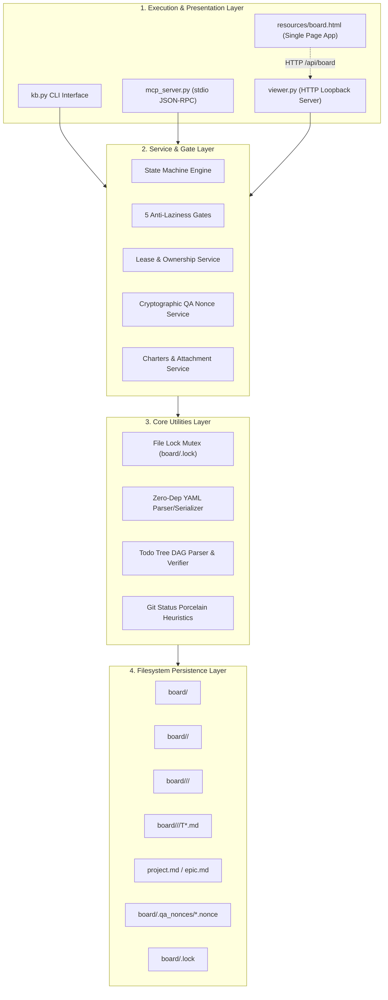

# System Architecture & Physical Design

KanbanBoard is engineered as an offline-first, file-backed state engine. It requires zero external databases, daemons, or heavy runtime dependencies, operating strictly on standard POSIX filesystem semantics and standard library Python.

---

## 1. Component Decomposition

The system is partitioned into five distinct, loosely coupled layers:



---

## 2. Physical File Hierarchy

The board state is stored entirely within a structured directory hierarchy under `board/`:

```
board/
├── .lock                                 # Inter-process mutex file (msvcrt / fcntl)
├── .qa_nonces/                           # Cryptographic ephemeral QA approval nonces
│   ├── kanban-system_core_T001.nonce    # Nonce issued to kb-qa upon audit start
│   └── ...
├── <project-1>/                          # Project top-level container
│   ├── project.md                        # Project Charter & Architectural Governance
│   ├── <epic-1>/                         # Epic sub-container
│   │   ├── epic.md                       # Epic Scope, Objectives & Architecture
│   │   ├── T001.md                       # Canonical Ticket file
│   │   ├── T002.md
│   │   └── ...
│   └── <epic-2>/
│       ├── epic.md
│       └── T003.md
└── <project-2>/
    └── ...
```

### 2.1 File Path Canonicalization
All ticket references follow the canonical 3-tuple format:
$$\text{ref} = \langle\text{project}\rangle / \langle\text{epic}\rangle / \langle\text{ticket\_id}\rangle$$
- Example: `kanban-system/core/T001`
- Resolves to: `board/kanban-system/core/T001.md`

Ticket IDs are zero-padded alphanumeric strings prefixed with `T` (e.g., `T001`, `T002`, `T100`).

---

## 3. Concurrency & Inter-Process Mutex Protocol

KanbanBoard supports concurrent access from multiple processes: primary coding agents, independent `kb-qa` auditing agents, CLI operators, and the live browser viewer. 

To eliminate race conditions, corrupted writes, or dirty reads, all mutations and read-modify-write sequences are guarded by an inter-process file lock at `board/.lock`.

### 3.1 Lock Implementation
The file lock is implemented in `kb.py` via the `board_lock(timeout=5.0)` context manager:

```python
import os
import sys
import time
from contextlib import contextmanager

if sys.platform == "win32":
    import msvcrt
    LOCK_EX = msvcrt.LK_NBLCK
    LOCK_UN = msvcrt.LK_UNLCK
else:
    import fcntl
    LOCK_EX = fcntl.LOCK_EX | fcntl.LOCK_NB
    LOCK_UN = fcntl.LOCK_UN

@contextmanager
def board_lock(timeout: float = 5.0):
    lock_file = BOARD_DIR / ".lock"
    lock_file.parent.mkdir(parents=True, exist_ok=True)
    fd = os.open(str(lock_file), os.O_CREAT | os.O_RDWR)
    deadline = time.time() + timeout
    acquired = False

    while time.time() < deadline:
        try:
            if sys.platform == "win32":
                msvcrt.locking(fd, LOCK_EX, 1)
            else:
                fcntl.flock(fd, LOCK_EX)
            acquired = True
            break
        except (IOError, OSError):
            time.sleep(0.05)

    if not acquired:
        os.close(fd)
        raise TimeoutError(f"Could not acquire board lock within {timeout}s")

    try:
        yield
    finally:
        try:
            if sys.platform == "win32":
                msvcrt.locking(fd, LOCK_UN, 1)
            else:
                fcntl.flock(fd, LOCK_UN)
        finally:
            os.close(fd)
```

### 3.2 Lock Semantics
1. **Non-blocking Spin-Wait**: Attempts lock acquisition in 50ms intervals until the deadline (default 5.0 seconds).
2. **Crash Resilience**: Because the lock is held by the operating system kernel on an open file descriptor (`fd`), if an agent process terminates unexpectedly, the OS automatically releases the kernel lock, preventing stale permanent deadlocks.
3. **Cross-Platform Compatibility**: Uses Windows `msvcrt.locking` on win32 and POSIX `fcntl.flock` on Linux and macOS.

---

## 4. Zero-Dependency Frontmatter Parser & Serializer

KanbanBoard eschews third-party YAML libraries (such as `PyYAML` or `ruamel.yaml`) to maintain zero runtime dependencies and maximum portability across vanilla Python 3.8+ environments.

### 4.1 Frontmatter Anatomy
Every ticket markdown file adheres to a strict dual-segment format:
1. **YAML Frontmatter**: Delimited by `---` lines at the top of the file, containing structured metadata.
2. **Markdown Body**: Free-form markdown containing sections such as `## Description`, `## Plan (Todo Tree)`, and `## Verification Evidence`.

```markdown
---
id: T001
project: kanban-system
epic: core
title: Implement State Machine
status: in-progress
owner: agent-alpha
claimed_at: '2026-11-20T08:00:00Z'
lease_expires_at: '2026-11-20T09:00:00Z'
files:
  - kb.py
  - mcp_server.py
docs:
  - kanban-system/project.md
  - kanban-system/core/epic.md
attachments:
  - path: tests/fixtures/spec.json
    description: Schema specification
    added_at: '2026-11-20T08:15:00Z'
prove: python -m unittest tests/test_kanban.py
---
## Description
Core state machine implementation for ticket lifecycles.

## Plan (Todo Tree)
- [x] 1. Define states and transition graph
- [ ] 2. Implement mechanical verification gates
  - [ ] 2.1 Plan gate
  - [ ] 2.2 Git porcelain gate [ACCEPTANCE]
```

### 4.2 Parser Grammar & Mechanics
The custom parser implements a deterministic line scanner:
- **Key-Value Pairs**: Matches `^([a-zA-Z0-9_-]+):\s*(.*)$`. Unquotes single/double quoted scalars. Casts numbers, booleans (`true`/`false`), and `None`/`null`.
- **Lists / Sequences**: Detects indented items starting with `- ` under list keys (`files`, `docs`, `attachments`).
- **Dict Elements in Lists**: Parses multi-line object structures inside lists (such as `attachments` records containing `path`, `description`, `added_at`).
- **Body Separation**: Splits on the second `---` delimiter line. Everything following is preserved verbatim as the markdown body.

---

## 5. System Execution Modes

1. **CLI Engine (`kb.py`)**: Direct command-line utility for human developers, shell scripts, and CI workflows.
2. **MCP Server (`mcp_server.py`)**: Zero-dependency stdio JSON-RPC 2.0 server exposing the 7 harmonized tools to AI agent runtimes.
3. **Web Viewer (`viewer.py`)**: Local micro-HTTP server that dynamically serves `resources/board.html` on loopback ports `7890–7899` with instantaneous client-side hydration via `window.__INITIAL_DATA__`.
