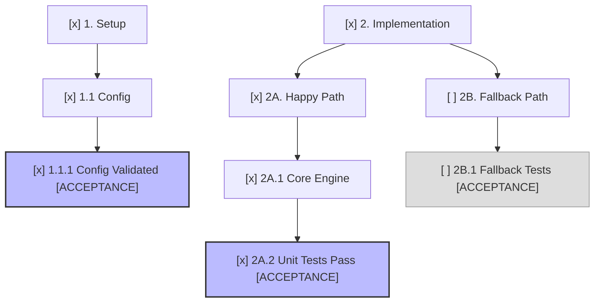

# Executable Todo Tree Grammar & Path Verification

The **Todo Tree** is KanbanBoard's core mechanism for structured, verifiable planning. It bridges high-level ticket requirements with low-level step execution by organizing tasks into a hierarchical Directed Acyclic Graph (DAG) using standard Markdown list syntax.

---

## 1. Syntax & Grammar Specification

The Todo Tree lives inside the ticket markdown under the header `## Plan (Todo Tree)`. It supports arbitrary nesting, alternative execution branches, and designated acceptance criteria.

### 1.1 Formal Grammar (EBNF)
```ebnf
TodoTree       ::= Header Item+
Header         ::= "## Plan (Todo Tree)" Newline
Item           ::= Indent Checkbox Label (Tag)? Newline
Indent         ::= ("  ")* | ("\t")*
Checkbox       ::= "- [ ] " | "- [x] " | "- [X] "
Label          ::= TaskID? Text
TaskID         ::= [0-9]+ ("." [0-9]+)* | [0-9]+ [A-Za-z]+
Tag            ::= "[ACCEPTANCE]"
```

### 1.2 Example Tree Structure
```markdown
## Plan (Todo Tree)
- [x] 1. Architecture & Design
  - [x] 1A. Define schema contracts
  - [ ] 1B. Alternative schema (Protobuf fallback)
- [x] 2. Core Implementation
  - [x] 2A. In-memory storage engine
    - [x] 2A.1 Thread-safe read/write locks
    - [x] 2A.2 Unit test coverage [ACCEPTANCE]
  - [ ] 2B. SQLite storage engine (Unused branch)
    - [ ] 2B.1 Schema migrations
    - [ ] 2B.2 DB integration test [ACCEPTANCE]
```

Notice that **Branch 1B** and **Branch 2B** were not selected during execution. That is fully permissible: the tree is fluid and allows branching alternatives. However, the path along **Branch 2A** is complete all the way from Root (1, 2) down to the leaf tagged `[ACCEPTANCE]`.

---

## 2. Stack-Based Parser Implementation

The parser operates by tracking indentation levels on a stack to dynamically reconstruct the tree's parent-child graph without external libraries.

```python
import re
from dataclasses import dataclass, field
from typing import List, Optional

@dataclass
class TodoNode:
    id: str
    text: str
    checked: bool
    is_acceptance: bool
    depth: int
    parent: Optional['TodoNode'] = None
    children: List['TodoNode'] = field(default_factory=list)

TODO_LINE_REGEX = re.compile(
    r'^(?P<indent>\s*)-\s*\[(?P<checked>[ xX])\]\s*(?P<text>.*?)(?P<tag>\[ACCEPTANCE\])?\s*$'
)

def parse_todo_tree(markdown_body: str) -> List[TodoNode]:
    in_plan = False
    root_nodes: List[TodoNode] = []
    stack: List[TodoNode] = []  # Stack of (ancestors)

    for line in markdown_body.splitlines():
        if line.strip().startswith("## Plan (Todo Tree)"):
            in_plan = True
            continue
        elif in_plan and line.startswith("## "):
            break  # Reached next section

        if not in_plan or not line.strip():
            continue

        match = TODO_LINE_REGEX.match(line)
        if not match:
            continue

        indent_len = len(match.group("indent").replace("\t", "    "))
        depth = indent_len // 2  # Standard 2-space indent
        checked = match.group("checked").lower() == "x"
        raw_text = match.group("text").strip()
        is_acceptance = bool(match.group("tag"))

        node = TodoNode(
            id=raw_text.split(" ")[0] if raw_text else "",
            text=raw_text,
            checked=checked,
            is_acceptance=is_acceptance,
            depth=depth
        )

        # Rebalance stack to find correct parent
        while stack and stack[-1].depth >= depth:
            stack.pop()

        if stack:
            node.parent = stack[-1]
            stack[-1].children.append(node)
        else:
            root_nodes.append(node)

        stack.append(node)

    return root_nodes
```

---

## 3. Continuous Path Verification Algorithm

To satisfy **Gate 3 (Unbroken DAG Path Gate)** before moving a ticket to `verify`, the engine must find at least one valid path from a root node to an `[ACCEPTANCE]` node where **every single node along the path is checked** (`checked == True`).



### 3.1 Verification Logic (Depth-First Search)

```python
def verify_unbroken_path(root_nodes: List[TodoNode]) -> bool:
    """Returns True if there is at least one unbroken checked path to an [ACCEPTANCE] leaf."""
    acceptance_leaves: List[TodoNode] = []

    def collect_acceptance(node: TodoNode):
        if node.is_acceptance:
            acceptance_leaves.append(node)
        for child in node.children:
            collect_acceptance(child)

    for root in root_nodes:
        collect_acceptance(root)

    if not acceptance_leaves:
        raise ValidationError("No [ACCEPTANCE] leaf nodes defined in Todo Tree.")

    # Check each acceptance leaf: walk upwards to the root
    valid_paths = []
    for leaf in acceptance_leaves:
        if not leaf.checked:
            continue

        # Traverse ancestry to root
        curr = leaf
        broken = False
        path = []
        while curr is not None:
            path.append(curr)
            if not curr.checked:
                broken = True
                break
            curr = curr.parent

        if not broken:
            valid_paths.append(list(reversed(path)))

    if not valid_paths:
        raise ValidationError(
            "Gate 3 Failed: No unbroken path of checked tasks leads to an [ACCEPTANCE] criterion. "
            "Ensure that an [ACCEPTANCE] task is checked AND all of its parent tasks are also checked."
        )

    return True
```

---

## 4. Checking Off Tasks via MCP & CLI

Agents update the Todo Tree dynamically during execution using `kanban_update`:

```python
# MCP call checking off tasks 1A, 2A, and 2A.2
kanban_update(
    ref="kanban-system/core/T001",
    checked_nodes=["1A", "2A", "2A.2"],
    notes="Completed in-memory storage engine and unit tests"
)
```

The engine matches target nodes by exact text, task identifier (e.g. `1A`), or line index, flips `- [ ]` to `- [x]`, and automatically updates the sliding lease timestamp.
