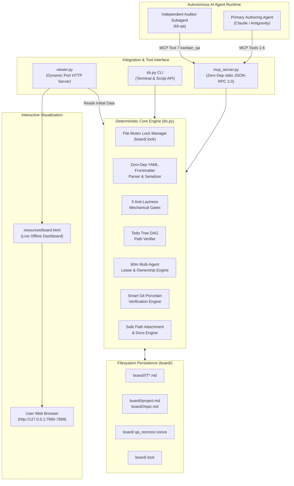

# KanbanBoard Technical Wiki

Welcome to the definitive technical reference and reverse-engineering manual for **KanbanBoard**, the universal, file-backed, multi-agent orchestration and quality assurance system designed for AI developer environments (Google Antigravity and Anthropic Claude Code).

---

## 1. Executive Summary & Vision

KanbanBoard bridges the gap between autonomous AI agents and rigorous software engineering workflows. It replaces unstructured, prone-to-drift chat interactions with a **deterministic, file-backed state machine** operating directly on physical filesystem artifacts (`board/**/*.md`).

Unlike cloud-dependent project management tools (Jira, Linear, GitHub Projects), KanbanBoard is:
- **Zero-Dependency & Offline-First**: Operates entirely via Python standard library and Markdown files.
- **Strictly Quality-Gated**: Employs five deterministic "Anti-Laziness Mechanical Gates" that prevent AI agents from cutting corners, faking verification, or submitting unreviewed changes.
- **Multi-Agent Collision-Proof**: Features an atomic 60-minute lease protocol with heartbeat renewals and audited takeovers.
- **Universal Dual-Platform Native**: Packages seamlessly as both an Antigravity (`agy`) native plugin and a Claude Code native plugin from a single unified codebase.
- **Self-Auditing & Ecosystem-Aware**: Enforces the **Ponytail Principle** (*"The best code is the code you never wrote"*) and **Ecosystem Blast-Radius Analysis** (*"When you cut down a tree, you don't just check the tree; you check the surrounding forest"*).

---

## 2. System Architecture at a Glance

The following diagram illustrates the interaction between autonomous agents, the unified 7-tool Model Context Protocol (MCP) server, the deterministic core engine, filesystem persistence, and the real-time visualization layer:



---

## 3. Wiki Navigation Matrix

This wiki is partitioned into two distinct reader journeys:
1. **Operator & Agent Manuals**: For developers, teams, and AI prompting engineers operating KanbanBoard.
2. **Systems Architecture & Reverse-Engineering Specifications**: For systems engineers, tool builders, and runtime implementers seeking to inspect, maintain, or rebuild the entire platform from scratch in any programming language (Python, TypeScript, Go, Rust).

| Document | Primary Target | Core Subject Matter |
| :--- | :--- | :--- |
| **[Architecture](file:///C:/Projects/kanbanBoard/wiki/Architecture.md)** | Architects & Engineers | Physical file layout, cross-process mutexes, zero-dependency parser, and runtime components. |
| **[State Machine & Lifecycle](file:///C:/Projects/kanbanBoard/wiki/State-Machine-and-Lifecycle.md)** | Everyone | The 5 lifecycle statuses, transition matrix, immutability of `done`, and cryptographic QA nonces. |
| **[Anti-Laziness Mechanical Gates](file:///C:/Projects/kanbanBoard/wiki/Anti-Laziness-Mechanical-Gates.md)** | Prompt Engineers & Auditors | Deep dive into the 5 automated code-level gates that reject lazy agent behavior. |
| **[Executable Todo Tree](file:///C:/Projects/kanbanBoard/wiki/Executable-Todo-Tree.md)** | Developers & Agents | Grammar, stack-based parser, and continuous path verification algorithm for branching DAG checklists. |
| **[Multi-Agent Leases & Ownership](file:///C:/Projects/kanbanBoard/wiki/Multi-Agent-Leases-and-Ownership.md)** | Multi-Agent Systems | Atomic move-and-claim, 60-minute sliding leases, heartbeat renewal, and audited force takeovers. |
| **[Smart Git Verification](file:///C:/Projects/kanbanBoard/wiki/Smart-Git-Verification.md)** | Systems Engineers | Git porcelain heuristics, single-ticket auto-merge vs multi-ticket explicit declaration. |
| **[Safe Attachments & Docs](file:///C:/Projects/kanbanBoard/wiki/Safe-Attachments-and-Docs.md)** | Security & Docs Teams | Path traversal boundaries, attachment tracking, and project/epic architectural documentation. |
| **[QA Ecosystem Protocol](file:///C:/Projects/kanbanBoard/wiki/QA-Ecosystem-Protocol.md)** | QA Engineers & `kb-qa` | Ponytail philosophy, Ecosystem Blast-Radius analysis, and Horse vs. Zebra discriminator testing. |
| **[MCP Server Specification](file:///C:/Projects/kanbanBoard/wiki/MCP-Server-Specification.md)** | Tool Integrators | Zero-dep stdio JSON-RPC 2.0 protocol, full schemas for the 7 tools, and `ui://` resource endpoints. |
| **[Web Dashboard & Viewer](file:///C:/Projects/kanbanBoard/wiki/Web-Dashboard-and-Viewer.md)** | Frontend & UX Teams | `viewer.py` loopback HTTP server, automatic port hunting (7890–7899), and offline data hydration. |
| **[Multi-Platform Distribution](file:///C:/Projects/kanbanBoard/wiki/Multi-Platform-Distribution.md)** | DevOps & Packaging | Single-folder universal manifest architecture supporting Antigravity (`agy`) and Claude Code. |
| **[Reverse-Engineering Guide](file:///C:/Projects/kanbanBoard/wiki/Reverse-Engineering-Guide.md)** | Comp-Sci & Re-implementers | Exhaustive formal grammar, algorithms, pseudo-code, and test cases to recreate KanbanBoard in any language. |

---

## 4. Quickstart Runbook

### 4.1 CLI Quickstart
```bash
# Display board overview (projects, epics, docs, active leases, completion %)
python kb.py status --overview

# Create a new ticket in the backlog
python kb.py new --project myproj --epic core --title "Implement JWT Authentication"

# Move ticket to in-progress (automatically claims ownership for 60 minutes)
python kb.py move myproj/core/T001 in-progress --agent agent-alpha

# Update Todo Tree checklist and declare touched files
python kb.py update myproj/core/T001 --check "1A,1B" --files "auth.py,models.py" --notes "Finished password hashing"

# Advance to verify (enforces Zero-Work Git Gate and Unbroken DAG Path Gate)
python kb.py move myproj/core/T001 verify

# Launch the interactive live web dashboard
python viewer.py
```

### 4.2 MCP Suite Quickstart (for Agents)
Agents interact with the system using 7 harmonized tools:
1. `kanban_board(view='overview')`: Discover project charters, active epics, and ticket statuses.
2. `kanban_ticket(ref='myproj/core/T001')`: Inspect frontmatter, attachments, and full Todo Tree plan.
3. `kanban_move(ref='myproj/core/T001', status='in-progress', agent_id='claude-1')`: Claim and start work.
4. `kanban_update(ref='myproj/core/T001', checked_nodes=['1A'], files=['src/auth.py'])`: Record progress.
5. `kanban_doc(action='read', project='myproj')`: Read architectural guidelines.
6. `kanban_view(open_browser=True)`: Launch visualization widget.
7. `kanban_qa(action='start', ref='myproj/core/T001')` & `kanban_qa(action='approve', ...)`: Restricted QA audit.
