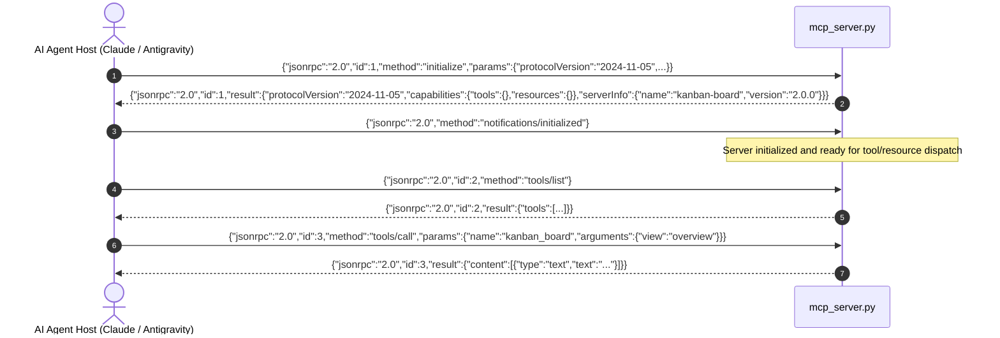

# Model Context Protocol (MCP) Server Specification

KanbanBoard exposes its functionality to AI agents via a streamlined, zero-dependency **Model Context Protocol (MCP)** server implemented in `mcp_server.py`. It communicates over standard I/O (`stdin`/`stdout`) using JSON-RPC 2.0.

---

## 1. Protocol Architecture & Handshake



### 1.1 JSON-RPC Transport Envelope
- Standard input/output line-delimited JSON.
- Every message must terminate with a standard newline `\n`.
- Internal logging is strictly directed to `stderr` (`sys.stderr.write`) so as never to corrupt stdout JSON-RPC framing.

---

## 2. The 7 Harmonized MCP Tools

The MCP toolset was intentionally consolidated from 14 disparate tools down to **7 cohesive, high-ergonomic tools**:

| Tool Name | Scope & Purpose |
| :--- | :--- |
| `kanban_board` | Unified discovery, explicit initialization, listing, and health checks (`overview`, `init`, `list`, `lint`). |
| `kanban_ticket` | Dual-mode inspector & creator (create ticket with auto-ID or read ticket). |
| `kanban_move` | Lifecycle transitions, atomic claims, 60m leases, and 5 mechanical gates. |
| `kanban_update` | In-flight progress logging, Todo Tree checkboxes, file declarations, attachments. |
| `kanban_doc` | Project charter & epic architectural specification management (`docs: []`). |
| `kanban_view` | Local web dashboard launcher & MCP UI widget generator. |
| `kanban_qa` | RESTRICTED QA audit protocol for `kb-qa` (start audit & approve with nonce). |

---

## 3. Tool Schemas & Parameter Specifications

### 3.1 `kanban_board`
Discovers projects, epics, tickets, leases, and architectural documentation.
```json
{
  "name": "kanban_board",
  "description": "Unified discovery, listing, and health checks for the Kanban board.",
  "inputSchema": {
    "type": "object",
    "properties": {
      "view": {
        "type": "string",
        "enum": ["overview", "init", "list", "lint"],
        "default": "overview",
        "description": "'overview': Complete discovery; 'init': explicitly initialize board and project charter; 'list': compact ticket list; 'lint': board structural health."
      },
      "project": { "type": "string", "description": "Filter by project name." },
      "epic": { "type": "string", "description": "Filter by epic name." },
      "status": {
        "type": "string",
        "enum": ["backlog", "in-progress", "verify", "done", "blocked"],
        "description": "Filter by ticket lifecycle status."
      }
    }
  }
}
```

### 3.2 `kanban_ticket`
Inspects an existing ticket or creates a new one in `backlog`.
```json
{
  "name": "kanban_ticket",
  "description": "Inspect an existing ticket or create a new ticket in backlog with a Todo Tree DAG.",
  "inputSchema": {
    "type": "object",
    "properties": {
      "ref": { "type": "string", "description": "Ticket reference ('project/epic/T001'). Omit when creating a new ticket." },
      "title": { "type": "string", "description": "If provided, creates a new ticket in backlog." },
      "project": { "type": "string", "description": "Target project when creating a ticket." },
      "epic": { "type": "string", "description": "Target epic when creating a ticket." },
      "description": { "type": "string", "description": "Problem statement & objective." },
      "plan": { "type": "string", "description": "Initial Todo Tree DAG plan (must include [ACCEPTANCE] leaf)." },
      "prove": { "type": "string", "description": "Concrete command to verify work." }
    }
  }
}
```

### 3.3 `kanban_move`
Atomic lifecycle transitions and lease ownership engine.
```json
{
  "name": "kanban_move",
  "description": "Transition ticket status, claim ownership, and enforce the 5 Anti-Laziness Gates.",
  "inputSchema": {
    "type": "object",
    "properties": {
      "ref": { "type": "string", "description": "Ticket reference ('project/epic/T001')." },
      "status": {
        "type": "string",
        "enum": ["backlog", "in-progress", "verify", "blocked"],
        "description": "Target status. NOTE: 'done' is restricted to kanban_qa tool."
      },
      "agent_id": { "type": "string", "description": "Agent session ID claiming the ticket when moving to in-progress." },
      "note": { "type": "string", "description": "Mandatory note when moving to blocked or handover." },
      "force": { "type": "boolean", "default": false, "description": "Force takeover if lease is active on another agent." },
      "reason": { "type": "string", "description": "Mandatory reason when force=true." }
    },
    "required": ["ref", "status"]
  }
}
```

### 3.4 `kanban_update`
Logs progress, checks Todo Tree nodes, declares files, manages attachments.
```json
{
  "name": "kanban_update",
  "description": "Record in-flight progress, check Todo Tree nodes, declare modified files, and manage attachments.",
  "inputSchema": {
    "type": "object",
    "properties": {
      "ref": { "type": "string", "description": "Ticket reference ('project/epic/T001')." },
      "checked_nodes": {
        "type": "array",
        "items": { "type": "string" },
        "description": "Node labels, IDs (e.g. '1A', '2.1'), or text to check off (- [x])."
      },
      "files": {
        "type": "array",
        "items": { "type": "string" },
        "description": "Files modified during this work step."
      },
      "notes": { "type": "string", "description": "Progress note or context handover update." },
      "attach_file": { "type": "string", "description": "Path to file to attach to ticket." },
      "attach_desc": { "type": "string", "description": "Description of the attachment." },
      "detach_file": { "type": "string", "description": "Path of file to detach." }
    },
    "required": ["ref"]
  }
}
```

### 3.5 `kanban_doc`
Charters and architectural documentation management.
```json
{
  "name": "kanban_doc",
  "description": "Read or write project charters and epic architectural specifications.",
  "inputSchema": {
    "type": "object",
    "properties": {
      "action": { "type": "string", "enum": ["read", "write"], "description": "Read or write charter/spec." },
      "project": { "type": "string", "description": "Target project." },
      "epic": { "type": "string", "description": "Target epic (optional if accessing project charter)." },
      "name": { "type": "string", "description": "Doc filename (defaults to project.md or epic.md)." },
      "content": { "type": "string", "description": "Markdown content when action='write'." }
    },
    "required": ["action", "project"]
  }
}
```

### 3.6 `kanban_view`
Viewer and interactive widget launcher.
```json
{
  "name": "kanban_view",
  "description": "Launch or connect to the view-only web dashboard widget.",
  "inputSchema": {
    "type": "object",
    "properties": {
      "open_browser": { "type": "boolean", "default": true, "description": "Launch user's default browser." }
    }
  }
}
```

### 3.7 `kanban_qa`
Restricted QA audit tool for `kb-qa` subagent.
```json
{
  "name": "kanban_qa",
  "description": "RESTRICTED: QA audit lifecycle tool for the independent kb-qa subagent.",
  "inputSchema": {
    "type": "object",
    "properties": {
      "action": { "type": "string", "enum": ["start", "approve"], "description": "'start' fetches spec & issues nonce; 'approve' burns nonce & marks done." },
      "ref": { "type": "string", "description": "Ticket reference ('project/epic/T001')." },
      "qa_nonce": { "type": "string", "description": "Cryptographic ephemeral nonce received during 'start'." },
      "evidence_path": { "type": "string", "description": "Path to 4-part QA evidence report." },
      "note": { "type": "string", "description": "Certification note." }
    },
    "required": ["action", "ref"]
  }
}
```

---

## 4. MCP Resources: `ui://kanban/board`

In addition to tools, `mcp_server.py` implements an MCP Resource endpoint:
- **URI**: `ui://kanban/board`
- **MIME Type**: `text/html`
- **Behavior**: Reads `resources/board.html`, injects the complete current board snapshot JSON into `window.__INITIAL_DATA__`, and returns the hydrated HTML string. This allows AI clients that support MCP App Widgets (e.g. Claude Desktop) to render the board natively inside chat panes.
