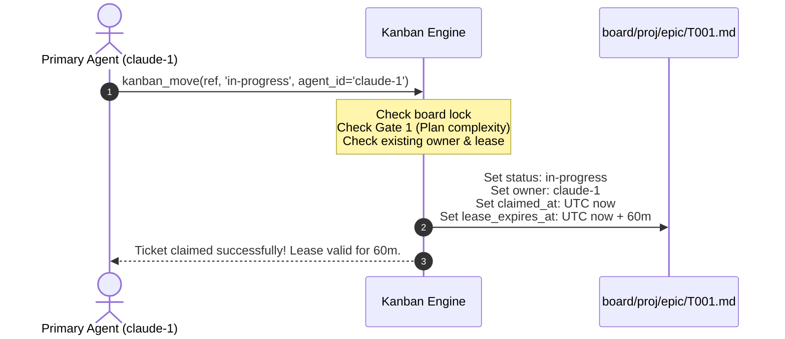
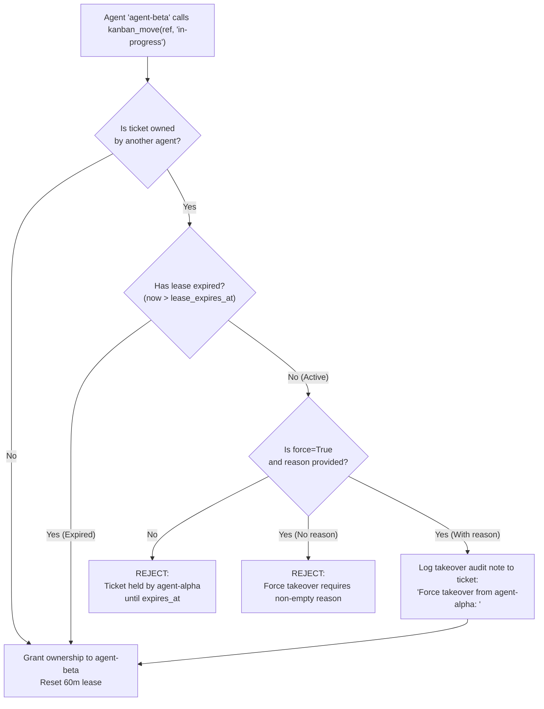

# Multi-Agent Leases & Ownership Model

In modern agentic environments, multiple AI agents (e.g., Claude Code, Antigravity, subagents, and background workers) may operate concurrently in the same repository. Without strict concurrency controls, agents can trample each other's code, duplicate work, or introduce conflicting changes.

KanbanBoard incorporates an atomic, file-backed **Lease & Ownership Model** directly into ticket metadata.

---

## 1. Ownership Schema & Attributes

Every ticket's YAML frontmatter contains three explicit ownership attributes:

```yaml
owner: agent-alpha                    # Unique identifier of the holding agent
claimed_at: '2026-11-20T08:00:00Z'    # ISO-8601 UTC timestamp of initial claim
lease_expires_at: '2026-11-20T09:00:00Z' # Sliding expiration deadline (now + 60m)
```

---

## 2. Atomic Move-and-Claim Protocol

In KanbanBoard, claiming a ticket is **never a disconnected two-step process**. Instead, the act of claiming is atomically coupled with transitioning a ticket into active work:

$$\text{backlog} \xrightarrow{\text{kanban\_move}(ref, \, \text{'in-progress'}, \, \text{agent\_id})} \text{in-progress} + \text{Claim}$$



---

## 3. Sliding Lease Heartbeat Renewal

AI development runs can encounter long builds, large test suites, or multi-turn agent investigations. To prevent active agents from losing their tickets prematurely while ensuring dead agents release their hold:

1. **Default Window**: Initial lease duration is exactly **60 minutes**.
2. **Heartbeat via Progress**: Whenever an agent performs productive work via `kanban_update(ref, checked_nodes=..., notes=...)`, the engine automatically resets the lease deadline:
   $$\text{lease\_expires\_at} \leftarrow \text{UTC\_NOW}() + 60\,\text{minutes}$$
3. **No Phantom Locks**: If an agent process crashes or disconnects, the ticket remains protected for up to 60 minutes, after which it becomes free for takeover.

---

## 4. Automatic Expiration & Force Takeover Protocol



### 4.1 Force Takeover Audit Trail
When an urgent takeover is required before the 60-minute expiration (e.g. human operator intervention or agent reboot), the caller must pass `force=True` and a mandatory `reason`:

```python
kanban_move(
    ref="myproj/core/T001",
    status="in-progress",
    agent_id="agent-beta",
    force=True,
    reason="agent-alpha disconnected after unhandled exception in build runner"
)
```

The engine logs an immutable audit event directly into the ticket body:
```markdown
> [!WARNING]
> **Takeover Event** (2026-11-20T08:35:12Z):
> Ticket forcefully claimed by `agent-beta` from `agent-alpha`.
> **Reason**: agent-alpha disconnected after unhandled exception in build runner.
```

---

## 5. Voluntary Release & Unclaiming

An agent can cleanly relinquish a ticket without abandoning work by moving it back to `backlog` or calling `kanban_move` with a note:
- Moving `in-progress` $\to$ `backlog` clears the `owner`, `claimed_at`, and `lease_expires_at` frontmatter fields.
- Work done on the Todo Tree and declared files is preserved on disk for the next agent to resume.
