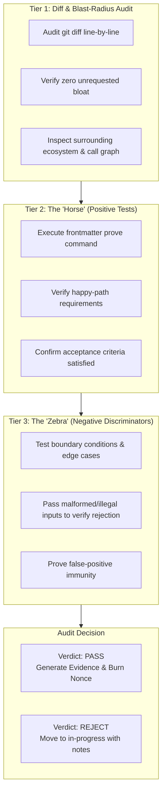

# High-Rigor QA Ecosystem Protocol

Quality Assurance in KanbanBoard is not an afterthought or a simple `assert True`. It is governed by an adversarial, 3-tier audit protocol executed exclusively by an independent `kb-qa` subagent.

---

## 1. Core Philosophies

### 1.1 The Ponytail Principle
> *"The best code is the code you never wrote."*

AI models often generate unnecessary boilerplate, premature abstractions, speculative utility classes, and superfluous comments. The Ponytail philosophy demands:
- **Minimal Diff Blast-Radius**: Every added line must have a direct justification in the ticket requirements.
- **Zero Premature Abstraction**: Do not introduce generic factory layers or polymorphic wrappers for single-implementation functions.
- **Dead Code Rejection**: Any unused helper or import is grounds for immediate QA rejection back to `in-progress`.

### 1.2 Ecosystem Blast-Radius Analysis
> *"When you cut down a tree, you don't just check the tree; you check the surrounding forest to see if it fell into something."*

Software systems are interconnected ecosystems. Modifying a module does not just affect that module's internal tests:
- Does modifying `auth.py` break the token validator in `api.py`?
- Does altering a database schema invalidate serialization in the caching layer?
- Does changing an MCP response signature break UI consumers?

The QA agent must explicitly analyze the **import graph, call hierarchy, and downstream dependents** of every touched file.

---

## 2. The 3-Tier Audit Hierarchy



### 2.1 Tier 1: Diff & Ecosystem Blast-Radius Review
The auditor reads every modified file line-by-line:
1. Are changes strictly scoped to the ticket requirements?
2. Are there accidental modifications, lint noise, or stray debug logs?
3. What other components import or call the changed interfaces?

### 2.2 Tier 2: Positive Behavior Verification (The "Horse")
Verifies that the requested functionality actually works as specified:
1. Runs the ticket's `prove:` command directly.
2. Validates that tests pass cleanly with non-zero assertions.
3. Confirms that acceptance criteria in the Todo Tree are physically satisfied.

### 2.3 Tier 3: Negative Discriminator Testing (The "Zebra")
*Why "Horse vs. Zebra"?* If a system claims it can identify a horse, a true test must also present it with a zebra, a donkey, and a striped horse to prove it does not simply classify every four-legged animal as a horse!

The auditor constructs adversarial discriminator test cases:
1. **Invalid Input Rejection**: What happens if input is `None`, empty string, negative integer, or oversized payload?
2. **Boundary Conditions**: Zero elements, off-by-one indices, concurrent access races.
3. **Graceful Error Handling**: Does the system throw clean, typed domain exceptions instead of unhandled crashes?

---

## 3. The 4-Part Evidence Report Schema

Before a ticket can be certified `done`, the `kb-qa` agent must write an evidence report to disk adhering to the following structure:

```markdown
# QA Evidence Report: <project>/<epic>/<ticket_id>

## Diff Review
- Line-by-line review of modified files.
- Verified minimal diff blast radius (no premature abstractions).
- Ecosystem impact: Checked downstream modules X and Y; verified zero regressions.

## Positive Tests
- Executed: `python -m unittest tests/test_kanban.py`
- Result: 4/4 tests passed (0.285s).
- Verified happy path: Created ticket, claimed lease, and moved through gates.

## Negative Discriminator Tests
- Discriminator 1: Passed premature checked acceptance task to Gate 1 -> correctly rejected.
- Discriminator 2: Attempted Gate 2 move with clean working tree -> correctly rejected with ZeroWorkError.
- Discriminator 3: Attempted Gate 3 move with broken ancestor node -> correctly rejected.

## Verdict: PASS
Ticket meets all architectural and quality gates. Certified for release.
```

---

## 4. Approval Execution via `kanban_qa`

Once the report is saved, `kb-qa` submits the approval:
```python
kanban_qa(
    action="approve",
    ref="kanban-system/core/T001",
    qa_nonce="e4a7b189c23d...",
    evidence_path="tests/evidence/T001_qa_report.md",
    note="Tier 1-3 audit complete. All discriminators verified."
)
```

The engine validates the nonce, audits the report sections, burns the nonce, and updates the ticket status to `done`.
