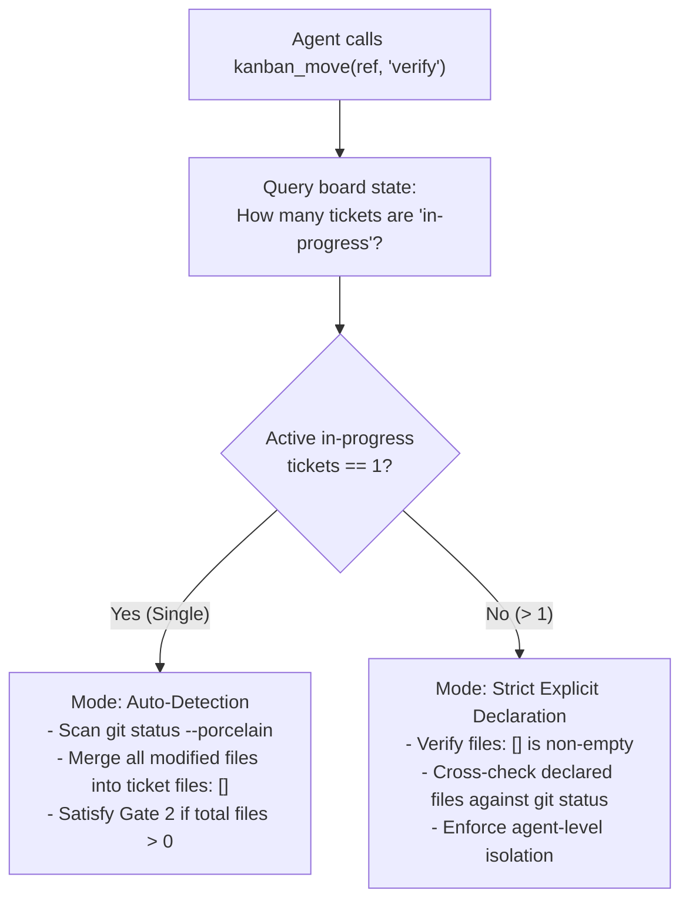

# Smart Git Verification Heuristics

Accurate tracking of files modified during ticket execution is essential for two reasons:
1. It forms the basis of the independent QA subagent's blast-radius audit.
2. It satisfies **Gate 2 (Zero Work Git Gate)**, rejecting premature transitions to `verify`.

However, in multi-agent environments where multiple tickets might be in progress simultaneously, naive git diffing will mistakenly lump unrelated files together. KanbanBoard implements **Smart Git Verification Heuristics** to resolve this dilemma.

---

## 1. Git Porcelain Parsing Engine

KanbanBoard queries the local git repository directly using standard porcelain output:
```bash
git status --porcelain=v1
```

### 1.1 Porcelain Status Decoder
The engine classifies modifications based on git's two-letter status indicators:

| Code | Staged Status | Working Tree Status | Classification |
| :--- | :--- | :--- | :--- |
| `M ` | Modified | Unmodified | Modified |
| ` M` | Unmodified | Modified | Modified |
| `MM` | Modified | Modified | Modified |
| `A ` | Added | Unmodified | Added |
| `D ` | Deleted | Unmodified | Deleted |
| `R ` | Renamed | Unmodified | Renamed |
| `??` | Untracked | Untracked | Added / New File |

Paths containing whitespace, quotes, or Unicode octal escapes (`"path/to/file\303\251.py"`) are normalized to standard POSIX forward-slash strings.

---

## 2. Dynamic Single vs. Multi-Ticket Heuristics

To balance convenience (automatic tracking) with isolation (no cross-ticket contamination), the engine examines the entire board state before attributing git changes:



### 2.1 Single-Ticket Mode (Auto-Merge)
When only **one ticket** is in `in-progress` on the entire board:
- The agent is assumed to have exclusive domain over the working directory.
- The engine executes git porcelain, discovers all modified, added, and untracked files, and **automatically merges them into the ticket's `files: []` frontmatter list**.
- Relieves the agent of tedious manual file declarations.

### 2.2 Multi-Ticket Mode (Strict Isolation)
When **two or more tickets** are in `in-progress` across different epics/projects:
- Automatic blanket assignment would contaminate ticket boundaries.
- The engine enforces strict explicit declaration: the agent **must explicitly declare** its touched files via:
  ```python
  kanban_update(ref="proj/epic/T001", files=["src/auth.py", "tests/test_auth.py"])
  ```
- The engine then verifies that at least one of the declared files appears in `git status --porcelain`.

---

## 3. Fallback in Non-Git Environments

While KanbanBoard is optimized for Git repositories:
- If a project directory is not a git repository (or git is not installed in the container), `kb.py` detects the absence of `.git`.
- In non-git environments, Gate 2 falls back to verifying that the ticket's frontmatter `files: []` list contains at least one existing physical file on disk.
- Ensures the system remains testable and functional in minimal air-gapped sandboxes.
