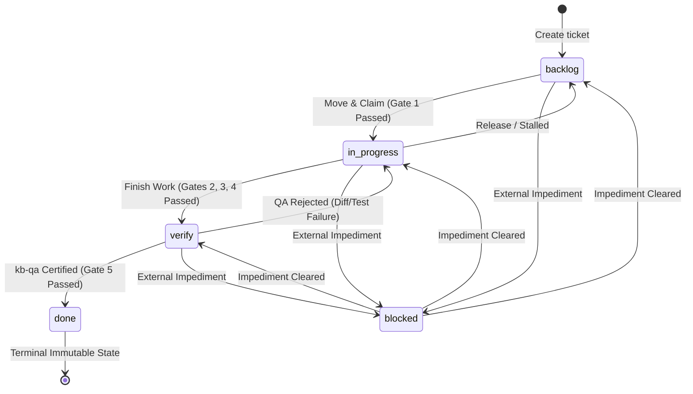
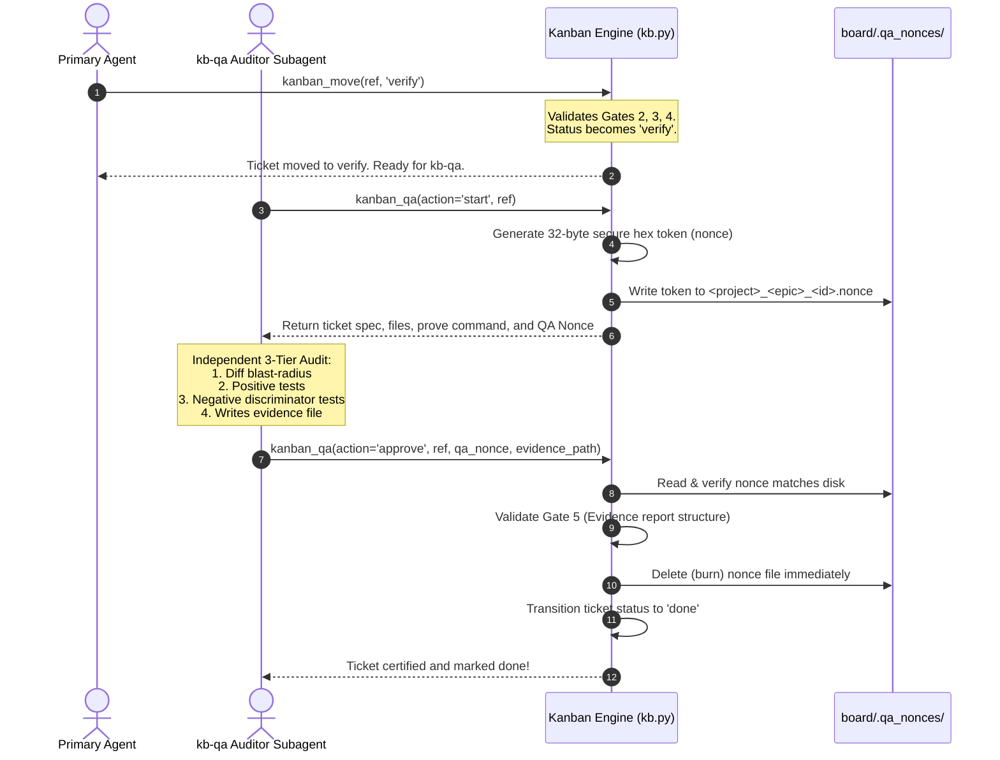

# State Machine & Ticket Lifecycle

At the core of KanbanBoard is a deterministic finite-state automaton (FSA). Every piece of work must transition through strictly governed lifecycle phases.

---

## 1. The 5 Lifecycle States



| State | Role & Description | Allowed Actor |
| :--- | :--- | :--- |
| `backlog` | Unassigned work item. Plan may be in draft. No active lock or lease. | Any agent / human |
| `in-progress` | Actively owned by an agent with a valid 60-minute sliding lease. | Ticket Owner only |
| `verify` | Implementation complete. Git changes verified. Locked for QA review. | Owner transitions to `verify` |
| `done` | **Terminal state.** Certified by independent `kb-qa` subagent with burned nonce. | `kb-qa` ONLY |
| `blocked` | Paused due to an external blocker (dependency, human input needed). | Any agent / human |

---

## 2. Transition Matrix & Permitted Moves

| Current State | Target State | Prerequisites & Mandatory Enforcements | Actor |
| :--- | :--- | :--- | :--- |
| `[*]` | `backlog` | Initial creation with Todo Tree template. | Anyone |
| `backlog` | `in-progress` | **Gate 1**: Valid non-trivial Todo Tree plan ($\ge 2$ levels or $\ge 3$ tasks, at least one unchecked `[ACCEPTANCE]` leaf). Claims 60m lease. | Primary Agent |
| `in-progress` | `verify` | **Gate 2**: Working git changes detected (`git status --porcelain`).<br>**Gate 3**: Unbroken DAG path from root to checked `[ACCEPTANCE]` leaf.<br>**Gate 4**: Concrete prove command (no mocks/echoes). | Ticket Owner |
| `verify` | `done` | **Gate 5**: `kanban_qa(action='approve')` called with valid ephemeral `qa_nonce` and conforming 4-part evidence report. | `kb-qa` ONLY |
| `verify` | `in-progress` | QA rejection. Nonce invalidated. Explanatory note added to ticket. | `kb-qa` / Owner |
| Any (except `done`) | `blocked` | Mandatory explanatory reason provided in `note`. | Any |
| `blocked` | Previous State | Unblocking note provided. | Any |

---

## 3. Terminal State Immutability

Once a ticket enters `done`, it is **permanently immutable**:
- Neither primary agents nor `kb-qa` can modify its frontmatter, Todo Tree, attachments, or status.
- Attempts to call `kanban_move` or `kanban_update` on a `done` ticket trigger a hard exception:
  ```
  InvalidTransitionError: Ticket 'myproj/core/T001' is in terminal state 'done' and cannot be modified.
  ```
- **Administrative Override**: If a finished ticket genuinely needs to be reopened due to regressions, a human operator must run the explicit CLI command:
  ```bash
  python kb.py move myproj/core/T001 backlog --force --reason "Regression identified in production audit"
  ```

---

## 4. Cryptographic QA Nonce Lifecycle

To prevent prompt injection, privilege escalation, or unauthorized self-approval by primary agents, ticket approval requires an ephemeral single-use token called a **QA Nonce**.



### 4.1 Security Properties of the Nonce
1. **Single-Use Burn**: As soon as `kanban_qa(action='approve')` succeeds, the nonce file is permanently deleted (`unlink`). It cannot be reused.
2. **Restricted Access**: Only the `kanban_qa` tool can issue or burn nonces. The standard `kanban_move` tool rejects moves to `done` outright.
3. **No Nonce Forwarding**: If a ticket is rejected back to `in-progress`, any existing nonce file is deleted. When moved back to `verify`, a fresh nonce must be generated.
