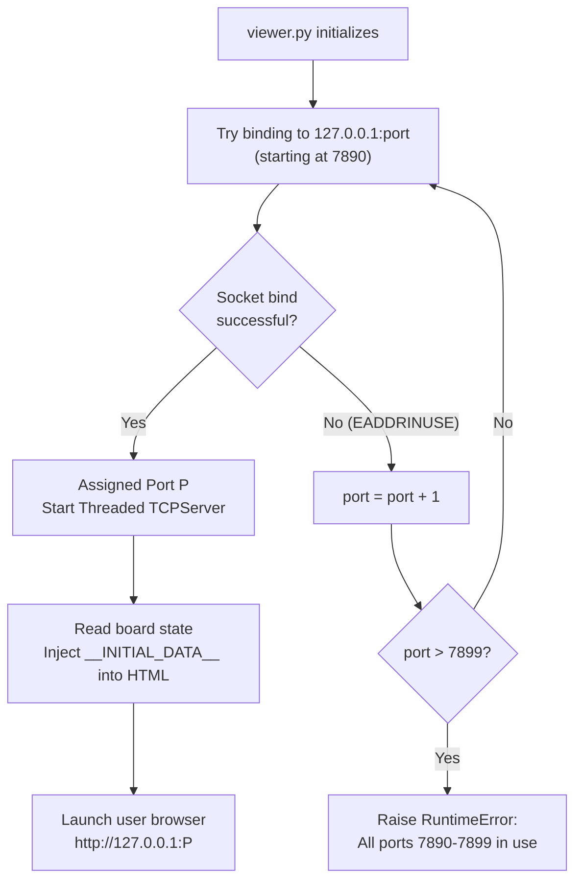

# Web Dashboard & Interactive Viewer

KanbanBoard includes an offline-ready, responsive web dashboard (`resources/board.html`) served by a lightweight Python standard-library loopback server (`viewer.py`).

---

## 1. Dynamic Port Probing Architecture

To guarantee conflict-free local execution without requiring user port configuration, `viewer.py` scans a 10-port loopback range:
$$\text{PortRange} = [7890, 7899]$$



---

## 2. Zero-Latency Initial Data Hydration

Unlike typical Single Page Applications (SPAs) that load an empty shell and display a loading spinner while awaiting asynchronous REST calls, KanbanBoard employs **instantaneous offline hydration**:

1. When the HTTP `GET /` request arrives at `viewer.py`, the server calls `get_board_data()`.
2. The entire board snapshot (tickets, columns, epics, leases, Todo Trees, attachments) is serialized to JSON.
3. The server performs a string substitution replacing:
   ```html
   <script>window.__INITIAL_DATA__ = null;</script>
   ```
   with:
   ```html
   <script>window.__INITIAL_DATA__ = {"projects": [...], "columns": [...]};</script>
   ```
4. When the browser receives the document, the DOM renders the full board in **0 milliseconds**, with zero layout shifts or loading spinners.

---

## 3. Real-Time Polling Endpoint

For long-running development sessions where agents update tickets in the background:
- The dashboard polls `GET /api/board` every 2.5 seconds.
- The viewer server handles `/api/board` requests by querying `get_board_data()` under a read lock.
- If data has changed, the frontend reconciles the DOM, updating:
  - Ticket column positions
  - Active lease countdown timers (`54m remaining`)
  - Checked Todo Tree completion meters (`3/5 tasks`)
  - Owner badges (`@claude-1`, `@kb-qa`)

---

## 4. Dashboard Visual Elements & Interactive Features

The single-page HTML application (`resources/board.html`) features:
1. **5-Column Responsive Layout**:
   - `Backlog` $\to$ `In Progress` $\to$ `Verify` $\to$ `Done` + `Blocked` side-tray.
2. **Interactive Ticket Cards**:
   - Expandable Todo Tree view showing hierarchical checkboxes and tags.
   - Live owner and lease expiration badges.
   - Attachment indicators with click-to-preview.
   - Related documentation links (`docs: []`).
3. **Filter & Search Controls**:
   - Filter by Project, Epic, Owner, or Text search.
4. **Dark/Light Theme**:
   - Clean, high-contrast engineering UI matching modern IDE aesthetic.
