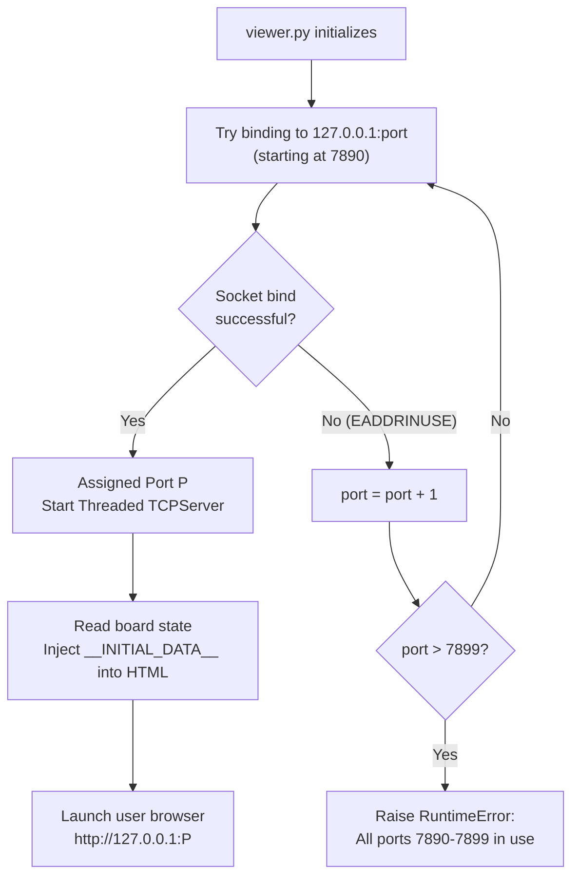

# Web Dashboard & Interactive Viewer

KanbanBoard includes an offline-ready, responsive web dashboard (`resources/board.html`) served by a lightweight Python standard-library loopback server (`viewer.py`).

---

## 1. Dynamic Port Probing Architecture

To guarantee conflict-free local execution without requiring user port configuration, `viewer.py` scans a 10-port loopback range:
$$\text{PortRange} = [7890, 7899]$$



---

## 2. Zero-Latency Initial Data Hydration

Unlike typical Single Page Applications (SPAs) that load an empty shell and display a loading spinner while awaiting asynchronous REST calls, KanbanBoard employs **instantaneous offline hydration**:

1. When the HTTP `GET /` request arrives at `viewer.py`, the server calls `get_board_data()`.
2. The entire board snapshot (tickets, columns, epics, leases, Todo Trees, attachments) is serialized to JSON.
3. The server performs a string substitution replacing:
   ```html
   <script>window.__INITIAL_DATA__ = null;</script>
   ```
   with:
   ```html
   <script>window.__INITIAL_DATA__ = {"projects": [...], "columns": [...]};</script>
   ```
4. When the browser receives the document, the DOM renders the full board in **0 milliseconds**, with zero layout shifts or loading spinners.

---

## 3. Real-Time Telemetry & Dual-Transport Architecture

For responsive multi-agent workflows where agents update tickets and leases in the background:
1. **Server-Sent Events (SSE) Push Stream (`GET /events` / `GET /api/events`)**:
   - `viewer.py` monitors file modifications across `board/**/*.md` using `board_stamp()` SHA-256 fingerprinting.
   - When any file change occurs, the server immediately pushes a lightweight SSE event `data: <hash>\n\n`.
   - The browser receives the notification and triggers an immediate `/api/board` reconcile without roundtrip delay.
   - Connection status pill reflects `live (SSE)` with green pulsing indicator.
2. **Debounced Polling Fallback**:
   - If SSE connection drops or is blocked by an intermediary proxy, the frontend gracefully falls back to periodic polling.
   - Status pill automatically transitions to `polling` or `offline`.
3. **Live Agent Lease Countdown Timers**:
   - The top header HUD continuously computes remaining lease time against `owner.lease_expires` timestamps (`1s` interval).
   - Color shifts automatically: normal blue/purple (`>15m`), warning amber (`<15m`), or red alert (`expired`).

---

## 4. Master Inspector Drawer (Bottom Panel)

Rather than cluttering the screen or obstructing board columns with modals or slide-over overlays, KanbanBoard features a **resizable bottom inspector drawer**:
- **Always-Visible Columns**: Maintains horizontal line-of-sight across all board columns.
- **Draggable Resizer Handle**: Drag the top border to resize the drawer between 240px and 92vh height.
- **Fullscreen Mode**: Toggle with `⛶ Expand` / `🗗 Restore` button.
- **Keyboard Shortcuts**: Close via `Esc`, focus search with `/`, toggle dark/light theme with `t`.

### 5-Tab Deep Inspection
1. **Tab 1: Visual DAG Graph**:
   - Groups tasks by execution lanes (`[lane:...]`).
   - Visually indicates node lifecycle: emerald for done, animated pulsing borders for active unblocked `ready_nodes`, gold badges for mandatory acceptance criteria, and muted strikethrough for skipped contingency branches (`- [-]`).
   - Displays explicit dependency prerequisites (`[after:A1,B2|C2]`).
2. **Tab 2: Ticket Spec & Plan**:
   - Clean, zero-void layout parsing Markdown sections (`## Outcome`, `## Scope`, `## Plan`, `## Prove`).
   - One-click "📋 Copy Command" button on verification blocks for instant terminal testing.
3. **Tab 3: Process Audit Stream**:
   - Full timeline of process execution proofs from `## Execution Log`.
   - Displays ISO timestamps, checkpoint IDs, status badges (`DONE`, `SKIP`), and recorded proof snippets.
4. **Tab 4: Touched Files & Attachments**:
   - Interactive list of files touched in the workspace with quick-copy path buttons.
   - List of safe attachments (`attachments/`) registered to the ticket.
5. **Tab 5: Living Architecture Reader**:
   - Slide-over markdown reader rendering `project.md` and `epic.md` directly within the drawer, keeping agents aligned with the living architectural contract.

---

## 5. Dashboard Visual Elements & Interactive Features

The single-page HTML application (`resources/board.html`) features:
1. **5-Column Responsive Layout**:
   - `Backlog` $\to$ `In Progress` $\to$ `Verify` $\to$ `Done` + `Blocked` side-tray.
2. **Interactive Ticket Cards**:
   - Progress bar with completed (`done`) and skipped (`skipped`) ratios.
   - Live owner and lease expiration countdown tags (`👤 antigravity 52m 14s`).
   - Attachment and touched file count badges.
3. **Filter & Search Controls**:
   - Filter by Project, Epic, Status, or Free-text query.
   - Checkbox to toggle hiding `done` tickets for focused work sessions.
4. **Dark/Light Theme**:
   - High-contrast engineering UI matching modern IDE aesthetics, persisted in `localStorage`.
